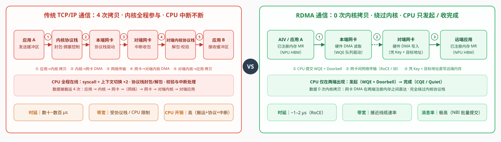
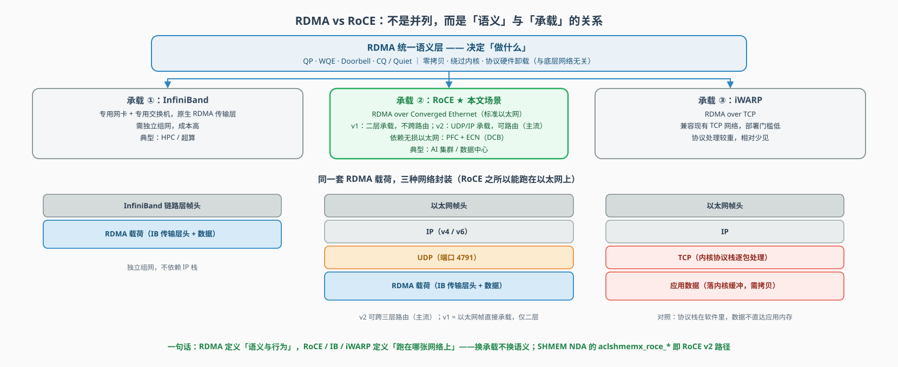
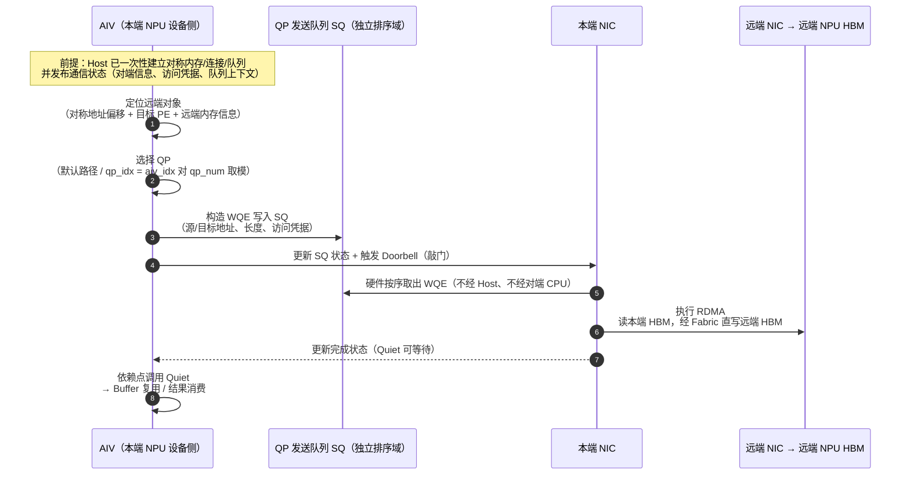

# CANN SHMEM NDA 技术系列（上 + 下）核心要点笔记

> 来源：华为内部社区（jx.huawei.com）
> - 上篇：《Ascend 950 代际，从数据直达到设备直驱》— 设计动机、产品架构与 AI 场景（postId=7ae3329c7f6540fe8c473135a1e7835a）
> - 下篇：《AIV 直驱 RDMA 的技术路径与实践》— 关键机制、接口与编程实践（postId=329b4d3242654b3aab5284ce473b4086）
> 代码仓：https://gitcode.com/cann/shmem ｜ 性能数据归档：https://gitcode.com/cann/shmem/wiki/Perftest.md

## 系列速览

| | 上篇 | 下篇 |
|---|---|---|
| 回答的问题 | **为什么需要 NDA**（控制路径为何下沉到设备） | **怎么用 NDA**（流程、接口、提交模式与调优） |
| 关键词 | NDR→NDA 演进、三个结构性矛盾、GPUDirect/GDAKI 类比、能力矩阵 | 端到端六步、四对象编程模型、异步三段式、Multi-QP/Aggregate、瓶颈调优 |

---

# 第一部分　上篇：Ascend 950 代际，从数据直达到设备直驱

## 上-1. 设计动机：带宽之外，通信控制路径成为新的系统变量

- 数据搬运问题（绕开 Host 中转、RDMA + 设备内存直达）已经成熟解决；AI 训推提出下一层问题：**通信由谁在正确的时刻发起**。
- 设备侧已掌握通信决策所需的全部信息：
  - MoE 门控结束后，Token 的目标 Expert 在设备侧确定
  - 分块计算中，下一块数据是否就绪由当前 Kernel 最清楚
  - Prefill 生成 KV Block 后，数据、目标实例、Ready 状态都在 NPU 执行上下文中
  - 多 AIV 并行处理不同数据流时，通信并发关系也在设备侧形成
- 若这些结果先返回 Host、再由 Runtime 组织网络任务：数据虽然保持直达，**控制链路仍被切成多段**——大块低频通信可被传输时间摊薄，但动态目标、细粒度消息、通算融合会受影响（消息率、流水深度、尾时延）。
- 反向做法（算子直接操作网卡队列）性能路径更短，但算子需理解各网卡的 QP、WQE、Doorbell 和完成机制，换一个 Backend 就要重新适配。

### 三个结构性矛盾 → NDA 的处理方式

| 结构性矛盾 | AI 负载中的表现 | NDA 的处理方式 |
|---|---|---|
| 决策位置与发起位置分离 | 路由、分块、调度结果在 AIV 中产生，网络任务由 Host 组织 | 让 AIV 直接把运行时结果转化为 RMA/AMO 操作 |
| 通信颗粒与 Host 任务颗粒不匹配 | Token、索引、计数器、状态标志频繁出现 | 设备侧 NBI、Multi-QP 与 Aggregate 提高高频提交效率 |
| 上层算法与网卡实现耦合 | 代际、网卡、队列与完成机制变化向算子扩散 | 统一 SHMEM 语义承接通信意图，由 Backend 完成适配 |

- 开发者关注点从"如何驱动某款网卡"收敛为"**访问哪个远端对象、采用什么操作、何时建立完成**"。

## 上-2. 从 NDR 到 NDA：数据直达之后，控制继续下沉

- **NDR（NPU Direct RDMA）**：NIC 直接访问 NPU Memory（数据直达），但通信任务、队列提交与完成推进主要由 CPU、Host Runtime 或代理线程组织。
- **NDA（NPU Direct Async）**：Host 完成初始化、建链和上下文准备；进入稳态后，AIV 在 Kernel 内完成目标选择、远端访问发起、队列提交与完成管理。

| 观察点 | NDR | NDA |
|---|---|---|
| 数据路径 | NIC ↔ NPU Memory 直达 | NIC ↔ NPU Memory 直达（不变） |
| 通信目标 | Host 任务预先表达 | AIV 根据 Kernel 运行结果决定 |
| 提交主体 | CPU / Runtime / Proxy | AIV |
| 队列控制 | Host 组织 WQE 并触发提交 | AIV 构造 WQE、选择 QP 并触发 Doorbell |
| 完成管理 | Host 或代理协调 | AIV 在设备侧执行 Quiet/Sync/Barrier |
| 稳态 CPU 角色 | 参与高频控制 | 聚焦初始化、管理与异常处理 |
| 通算编排 | 受 Host 与 Kernel 边界约束 | 可嵌入同一 Kernel 的数据依赖流水 |

- NDA 的变化体现在执行链路：通信目标无需离开 Kernel 上下文、NBI 可更早发起、完成等待放到真实依赖点、多条设备侧数据流映射到不同 QP 并行推进。
- CPU 由此退出高频逐操作提交链路，专注控制面（进程启动、对称内存建立、网络资源准备、连接管理、通信状态发布）。

## 上-3. 与 NVIDIA 体系的架构类比（GPUDirect RDMA / IBRC / GDAKI）

| 架构类型 | NVIDIA 体系对应能力 | 稳态通信控制 | 类比 |
|---|---|---|---|
| 数据直达 + Proxy 提交 | GPUDirect RDMA 数据路径；NVSHMEM IBRC 等 proxy-based transport | Device API 请求交给 CPU proxy thread 发起远端传输 | ≈ **NDR** |
| GPU-initiated networking | GDAKI（GPUDirect Async Kernel-Initiated），经 IBGDA 或 GPUNetIO transport | GPU threads 直接驱动 NIC，控制面和数据面留在 GPU | ≈ **NDA** |

- 比较的是**控制路径**层面：NDA 与 GDAKI 都把稳态网络控制放进设备 Kernel，但双方接口、协议、队列格式、硬件实现各自独立。
- NDA 的差异化定位：既包含 AIV 直接驱动 RDMA 的执行路径，也通过 SHMEM 语义层屏蔽 XSCALE、HNS_1825 与 IN_DIE 的实现差异，更强调**跨代际演进、上层易用性和算子可组合性**。

## 上-4. 架构定位：一层稳定的设备通信语义（IR-like）

- 分层结构：AI 业务与融合算子（MoE / TP / P·D 解耦 / KV Cache / AscendC 自定义算子）→ **SHMEM 编程模型**（Symmetric Memory、PE/Team、RMA、AMO、Quiet、Fence、Sync、Barrier）→ **双执行平面**（Host 控制面准备资源并发布通信状态；AIV 数据面执行高频远端访问与完成管理）→ **Backend 适配**（XSCALE、HNS_1825、IN_DIE：地址转换、队列映射、WQE/DB 适配、完成推进）。
- 把"通信意图"和"网卡机制"拆开：上层接口稳定，新网卡/新代际变化集中在适配层，性能优化不改写业务算法。
- 两层使用方式：通用 SHMEM Device API（大多数算子）+ RoCE 性能扩展 API（显式控制 QP 与提交，面向消息率和队列并发敏感的热点路径）。

| 能力类别 | A5 XSCALE 云脉 | A5 HNS_1825 | A2/A3 IN_DIE | 作用 |
|---|:-:|:-:|:-:|---|
| Device Put/Get 与 NBI | ✓ | ✓ | ✓ | 设备侧远端读写与异步发起 |
| Quiet/Sync/Barrier | ✓ | ✓ | ✓ | 完成管理与跨 PE 协同 |
| QP-specific RMA | ✓ | ✓ | — | 多 AIV、多逻辑流并行提交 |
| RDMA Atomic | ✓ | — | — | 远端计数与状态更新 |
| Aggregate 提交 | ✓ | — | ✓ | 摊薄连续小操作的提交成本 |
| 统一 SHMEM Device 语义 | ✓ | ✓ | ✓ | 屏蔽代际与 Backend 差异 |

- 低门槛渐进路径：先通用 NBI + Quiet 建立正确数据依赖 → 并发提交成为瓶颈时引入 QP-specific → 连续小操作提交成本突出时启用 Aggregate。

## 上-5. NDA 如何进入 AI 训练与推理（三大场景）

| 场景 | 设备侧已掌握的信息 | NDA 编排方式 | 直接价值 |
|---|---|---|---|
| MoE Dispatch/Combine | Token 路由、目标 Expert、目标 PE、Offset | 按目标组织数据，Put NBI，Multi-QP 并发，Atomic/Ready 衔接计算 | 路由结果直接驱动通信，减少控制转换 |
| 通信计算融合 | 当前 Tile、下一 Tile 需求、消费时刻 | 提前 Get/Put，执行独立计算，在依赖点 Quiet | 把网络等待压入算子流水 |
| P/D 解耦与 KV Cache | KV Block、目标实例、Metadata、Ready 状态 | 数据与状态按序发布，Decode 侧按协议消费 | 缩短数据生产到远端消费的控制链路 |

- **MoE：让路由结果直接变成网络行为**——门控后 AIV 按目标 PE/Expert 连续化 Token/Metadata/Gate Weight 并直接发起远端写；多 QP 承载不同 AIV/逻辑流，Aggregate 适合连续小操作，Atomic/Ready 连接远端 Expert FFN；路由、通信、计算保持上下文连续。
- **通算融合：把完成点放在真正需要的位置**——Tile N 计算期间预取 Tile N+1，NBI 提前发起、独立计算继续、Quiet 位于下一 Tile 消费前；通信由独立阶段进入 Kernel 内部流水。
- **P/D 解耦：数据与状态在设备侧协同发布**——Prefill 直传 KV 数据 + 更新 Block Metadata + 发布 Ready；Decode 依据明确完成/消费协议执行；适合动态目标、细粒度 Block 和设备侧服务链路。

## 上-6. 易用性：从一条通用路径开始，按瓶颈逐层增强

```cpp
aclshmemx_roce_put_nbi(remote_dst, local_src, elem_size, pe);  // 把数据发往哪个 PE
compute_independent_work();                                     // 哪些计算可与通信并行
aclshmemx_roce_quiet(pe);                                       // 在哪里建立完成依赖
```

| 阶段 | 使用方式 | 适合解决的问题 |
|---|---|---|
| Level 1：通用异步 RMA | NBI + Quiet | 建立设备侧通信与计算流水 |
| Level 2：Multi-QP | 按 AIV/Channel/数据流映射 QP | 扩展并行提交能力 |
| Level 3：Aggregate | 多个操作聚合后统一提交 | 降低连续小操作的平均提交成本 |

- 上层算法不因性能层次变化而重写通信模型：统一语义层保持稳定，Backend 与性能扩展负责深层优化——这是 NDA 相较单一网卡直驱接口的重要产品价值。

## 上-7. 上篇总结

- AI 训推中的通信正从静态大块搬运走向**动态目标、细粒度状态和算子内流水**；数据直达解决了搬运路径，设备直驱进一步让通信决策、提交和完成回到 AIV 当前执行上下文。
- NDA = 统一设备通信语义（承接上层算法）+ Host/AIV 分工（控制面/数据面）+ 三类 Backend Lowering（XSCALE、HNS_1825、IN_DIE）。
- 算子看到的是远端对象、目标 PE、操作和依赖；底层负责队列、提交与完成。
- 核心价值：让设备侧通信同时具备**性能路径、统一抽象和跨代际演进能力**。

> 参考资料：NVIDIA GPUDirect RDMA、NVSHMEM Device APIs（Proxy-Based Transport 与 GDAKI Transport）、NCCL Device-Initiated Communication 与 GIN、DOCA GPUNetIO。

---

# 第二部分　下篇：AIV 直驱 RDMA 的技术路径与实践

（以下为下篇要点，章节号保持原编号 1–11）

## 1. 总体设计理念

- **一句话**：统一语义 + Backend Lowering + 分层性能扩展——常规路径保持简洁，热点路径再逐层开放 QP、提交与完成控制。
- 目标：设备侧通信的表达像一次本地内存操作一样容易，同时保留异步、队列并发和完成控制。
- 关键性质：通用路径与性能扩展路径**共享同一套地址模型与完成语义**，调优不需要重写整个通信协议。

## 2. 分层架构

| 层 | 职责 | 运行特征 |
|---|---|---|
| Host 控制面 | 进程/PE 初始化、对称内存、网络资源、连接建立、通信状态发布（Device Communication State） | Kernel 启动前一次性完成 |
| AIV 数据面 | 远端地址计算、QP 选择、WQE 构造、队列提交、Doorbell、完成等待 | 随计算流水持续执行（稳态） |
| Backend | 将统一操作转换为具体网卡的 WQE/SQ/Doorbell 动作 | 按网卡适配 |
| 完成原语 | Quiet / Sync / Barrier 把完成关系带回 Kernel 的数据依赖 | 依赖点执行 |

- 低频资源准备与高频设备通信分离：Kernel 运行后 AIV 反复复用 Host 发布的通信状态，Host 管生命周期，AIV 驱动通信关键路径。

## 3. 一次 AIV Put 的端到端流程（六步）

1. **定位远端对象**：本地对称地址偏移 + 目标 PE + 远端内存信息 → 目标地址
2. **选择通信队列**：默认路径，或 QP-specific 把不同通信流映射到独立 QP
3. **构造 WQE**：源/目标地址、长度、访问凭据组织为 RDMA 操作描述
4. **提交到 NIC**：WQE 进发送队列，更新队列状态并触发 Doorbell
5. **执行 RDMA**：NIC 从本端 NPU HBM 读数据，经 Fabric 直写远端 NPU HBM
6. **建立完成**：NIC 更新完成状态，AIV 在依赖点调 Quiet/同步原语后复用 Buffer

> 计算、网络提交、完成等待都在**同一 Kernel 执行上下文**内；MoE 路由、Tile 预取、KV 传输均可复用此流程。

### 3.0 基础概念：RDMA 与 RoCE

**RDMA（Remote Direct Memory Access，远程直接内存访问）**

- 传统 TCP/IP 通信路径：应用缓冲区 → 本端内核协议栈（拷贝）→ 网卡 → 对端网卡 → 对端内核协议栈（拷贝）→ 应用缓冲区，多次内存拷贝 + 两端内核参与 + CPU 中断处理，时延高、CPU 开销大。
- RDMA 让**网卡硬件直接在本端应用内存与远端应用内存之间搬运数据**：
  - **绕过内核**（Kernel Bypass）：不经过协议栈
  - **零拷贝**（Zero-copy）：数据不落中间缓冲区
  - **CPU 只负责发起与完成控制**，不参与逐字节搬运
- 收益：微秒级时延、接近线缆速率的带宽、极低 CPU 占用——大规模 AI 集合通信与参数同步的物理基础。
- 使用前提：通信双方先**注册内存区域（MR）**并获得访问凭据（Key），远端凭 Key + 目标地址直接读写本端内存；提交侧配合 QP / WQE / Doorbell（见 3.1），完成侧由 CQE（完成队列项）/ Quiet 告知。
- 三种常见承载方式：

| 承载 | 说明 | 典型场景 |
|---|---|---|
| InfiniBand | 专用网卡 + 专用交换机的原生 RDMA 网络 | HPC / 超算 |
| **RoCE** | RDMA over Converged Ethernet，跑在标准以太网上 | 数据中心 / AI 集群（本文场景） |
| iWARP | RDMA over TCP | 相对少见 |

#### RDMA vs 传统 TCP/IP：数据路径与性能对比



| 维度 | 传统 TCP/IP | RDMA | 对应机制 |
|---|---|---|---|
| 数据面拷贝 | 4 次（应用↔内核 ×2，内核↔网卡 ×2） | **0 次**（NIC DMA 在两端注册内存间直达） | 零拷贝 |
| 内核参与 | 每条消息系统调用 + 协议栈处理 + 上下文切换 | 数据面**完全绕过内核** | Kernel Bypass |
| CPU 开销 | 高：封包、校验、拷贝、中断全程参与 | 低：仅发起（WQE）与完成（CQE/Quiet） | 硬件卸载 |
| 典型单程时延 | 数十~数百 μs 量级 | 微秒级（同集群 RoCE ~1–2 μs） | 路径大幅缩短 |
| 带宽 | 受协议栈/CPU 瓶颈，高速链路难打满 | 接近线缆速率（100/200/400 Gbps） | 硬件 DMA |
| 小消息消息率 | 受 syscall/中断频率上限约束 | 极高（设备侧高频 NBI 批量提交） | 用户态/设备态提交 |

> 一句话：TCP/IP 是"数据走内核、CPU 搬砖"；RDMA 是"数据走硬件直通道、CPU 只发指令和收完成"。零拷贝省掉中间缓冲，Kernel Bypass 省掉协议栈与切换，两者叠加成就微秒级时延与极高消息率——这是 NDA 让 AIV 在设备侧高频发起通信的物理前提。

#### RDMA 的硬件依赖：DMA 之上的一整套卸载能力

DMA 是数据面的"搬运手"，但 **RDMA ≠ 单纯的 DMA**——它是网卡上一整套硬件卸载能力的组合，DMA 只是其中的地基：

| 层 | 硬件能力 | 作用 | 没有它行不行 |
|---|---|---|---|
| 数据搬运 | **DMA 引擎** | 网卡直接读/写内存，不经 CPU | 普通网卡也有 DMA，仅有 DMA 只能"本机搬数据"，成不了 RDMA |
| 远端寻址 | **MR/Key + VA→PA 硬件翻译**（类似 IOMMU） | 对端网卡凭 Key + 虚拟地址，直接 DMA 写进**对端应用内存**的指定位置 | RDMA 的灵魂——普通网卡收包只能写内核缓冲区，做不到"指定写对端应用内存第 X 字节" |
| 协议卸载 | **可靠传输引擎**（排序、重传、流控在硬件里） | 把 TCP 该干的事全卸载到网卡，才敢绕过内核 | 不卸载就得回内核软件处理，低时延无从谈起 |
| 控制直通 | **WQ/Doorbell/CQ 用户态映射** | 应用（或 AIV）在用户态/设备态直接构造 WQE、敲 Doorbell、轮询完成 | 缺了它每次提交都陷入内核，Kernel Bypass 失效 |
| 数据直达（NDA 场景） | **NIC DMA 可直接寻址 NPU HBM** | 不只是主机内存——这是"NPU Direct"的硬件前提 | XSCALE/HNS_1825 提供的正是这条 NPU HBM ↔ NIC DMA 通路；叠加 AIV 设备侧直发 WQE 才构成完整 NDA 链路 |

反证：**SoftRoCE（rxe）** 用纯软件在普通以太网卡上模拟 RDMA 语义——接口完全一样，但拷贝、协议处理全回软件，时延从 ~1 μs 退化到几十 μs。硬件层缺任何一块，"RDMA"都只剩个名字。

**RoCE（RDMA over Converged Ethernet）**

- 本质：把 RDMA 语义（QP、WQE、Doorbell、完成机制）封装进以太网帧传输，让 RDMA 跑在**标准以太网基础设施**上，无需专用 InfiniBand 网络。
- 两个版本：
  - RoCE v1：以太网链路层（二层）承载，不能跨路由器
  - **RoCE v2：UDP/IP 承载（UDP 4791 端口），可三层路由，当前主流**——文中 Ascend 的 RoCE 路径即 v2
- 关键依赖：**无损以太网**。RDMA 把传输协议卸载到网卡硬件、丢包重传代价高，因此网络需配置 PFC（优先级流控，按优先级暂停防丢包）、ECN（显式拥塞通知）等 DCB 特性。
- 在 NDA 语境中的位置：`aclshmemx_roce_*` 系列接口即基于 RoCE 的 RDMA 路径；A5 的 XSCALE（云脉）、HNS_1825 网卡经 RoCE fabric 实现**本端 NPU HBM ↔ 远端 NPU HBM 直写**，与 AIV 设备侧直驱（3.1）组合成完整链路。

#### RDMA 与 RoCE 的关系图



### 3.1 QP 是什么：一图看懂工作流程（结合 AIV 动作）

**QP（Queue Pair，队列对）** 是 RDMA 中两节点之间的专用通信通道，由 **SQ（发送队列）+ RQ（接收队列）** 组成。本端把通信操作组织成 **WQE** 放入 SQ，网卡硬件直接消费执行，全程绕过 Host。关键语义：**一个 QP = 一个独立排序域**——QP 内操作严格按序完成，QP 之间无顺序保证（这正是三种提交模式的根基）。



> 注：RQ（接收队列）用于承接对端发起的操作，本图以 Put（纯发送场景）为主，故未展开。
> 类比：QP 之于 RDMA，如同 TCP 连接之于 socket——但由网卡硬件直驱、绕过内核，且 AIV 可在设备侧直接构造和提交。

## 4. 编程模型：四个对象

| 对象 | 解决的问题 | 典型接口/概念 |
|---|---|---|
| Symmetric Memory | 如何稳定定位远端对象 | `aclshmem_malloc`、对称地址 |
| PE / Team | 通信发生在哪些参与者之间 | PE、Team、World |
| RMA / AMO | 对远端数据执行什么操作 | Put、Get、Atomic、Signal |
| Completion / Sync | 何时允许继续执行 | Quiet、Fence、Sync、Barrier |

映射关系：Tensor/Token/KV Block → 对称对象；目标卡 → PE；通信动作 → RMA/AMO；消费关系 → 完成与同步。

### 两层 Device API

| 层次 | 代表接口 | 场景 |
|---|---|---|
| 通用 SHMEM Device API | `aclshmem_putmem_nbi / getmem_nbi / quiet` | 通用融合算子、跨 Transport |
| RoCE Device 扩展 | `aclshmemx_roce_put_nbi / get_nbi / quiet` | 直接使用 RDMA 路径 |
| QP-specific 扩展 | `aclshmemx_roce_qp_*` | 多 AIV、多通信流并行 |
| Aggregate 扩展 | defer/submit 形式的 RoCE Put/Get | 连续小消息提交 |

## 5. 异步三段式（NDA 最核心使用方式）

```cpp
aclshmemx_roce_put_nbi(dst, src, elem_size, pe);  // Issue Early：尽早发起
compute_independent_tile();                        // Compute in Between：重叠无依赖计算
aclshmemx_roce_quiet(pe);                          // Complete on Dependency：依赖点完成
consume_or_reuse_buffer();
```

- **Quiet 位置跟随数据流，而不是机械跟随每次 Put/Get**：
  - 正确性：数据完成前不能进入依赖该数据的下一阶段
  - 性能：Quiet 越靠近真实依赖，可重叠窗口越完整
- 场景化放置：MoE → 目标分组发送结束后；Tile Pipeline → 下一 Tile 消费前；KV Cache → Ready 状态发布前

## 6. 完成语义：四个原语

| 原语 | 语义 | 典型位置 |
|---|---|---|
| Fence | 建立前后远端操作的**顺序** | 数据与后续控制操作需有序时 |
| Quiet | 等待发起域中**前序通信完成** | Buffer 复用、Get 消费、阶段切换前 |
| Sync | 参与 PE **到达同一同步点**（会合） | 各 PE 完成本地通信阶段后 |
| Barrier | 前序更新完成 **+ 参与者会合** | 全体 PE 共享同一数据依赖时 |

## 7. 提交模式：Single-QP / Multi-QP / Aggregate

### 7.0 三种模式多维度对比

| 对比维度 | Single-QP | Multi-QP | Aggregate |
|---|---|---|---|
| **核心机制** | 所有通信走一个 QP，单一稳定排序域 | 通信流映射到多个独立 QP，并行提交 | 单个 QP 内多个 WQE 聚合，最后一次统一 Submit |
| **排序语义** | QP 内严格按序，天然有序 | QP 内有序，**QP 之间无序** | 聚合窗口内仍按提交顺序发出 |
| **提交并行度** | 低（单队列易串行化） | 高（多排序域并行） | 不变（并行度靠 QP，只降提交次数） |
| **Doorbell/提交开销** | 每操作一次 | 每操作一次，分散到多队列 | 一组小操作共享一次 Submit，显著降低 |
| **解决的瓶颈** | —（基础路径，语义最简） | Issue/Queue-bound（多 AIV 单队列串行） | Submission-bound（小消息 Doorbell 成本高） |
| **典型通信形态** | 单流通信、控制消息、基础 RMA | 多 AIV、多 Channel、多目标流 | 连续小消息、短突发（Token 分片、Metadata 更新） |
| **典型接口** | `aclshmemx_roce_put_nbi` | `aclshmemx_roce_qp_put_nbi / qp_quiet` + `qp_idx` | `put_nbi(..., defer)` × N + 末次 `submit` |
| **完成管理** | 单一 Quiet 域 | 按 QP 分别 Quiet（队列级完成，与通信流一一对应） | Quiet 作用于整个发起域 |
| **支持后端** | RDMA 基础路径（全部网卡） | XSCALE、HNS_1825 | XSCALE、IN_DIE |
| **注意事项** | 多流集中时 Issue 串行化成为瓶颈 | 需稳定映射保序；QP 数量增加资源占用 | 聚合深度权衡提交效率与等待时延；大消息不适用 |
| **相互关系** | 基础 | 扩展排序域**并行度**（横向扩展） | 优化**单队列内提交频率**（纵向优化），可与 Multi-QP 组合 |

- **Multi-QP 映射方式**：按 AIV / Channel / 数据类型 / 目标 PE 分配 QP（`qp_idx = aiv_idx % qp_num`），稳定映射保持队列顺序。
- **Aggregate**：defer 累积 → 最后一次 submit；聚合深度 = 提交效率与等待时间的平衡。
- 两者维度不同：Aggregate 优化**单队列内提交频率**，Multi-QP 扩展**排序域并行度**，可组合。

### 实用选择顺序（先 Profiling 再动手）

| Profiling 现象 | 优先考虑 |
|---|---|
| 通信可与计算重叠，但路径仍逐操作等待 | NBI + 依赖点 Quiet |
| 多 AIV/数据流集中单队列，Issue 串行化 | Multi-QP |
| 连续小操作多，Doorbell/提交频率高 | Aggregate |
| 大消息已接近链路带宽 | 优化数据组织与流水，**不盲目加 QP/聚合深度** |

## 8. 多 Backend Lowering

统一语义与网卡机制解耦：地址/PE 定位、Put/Get/Atomic 执行、NBI 完成推进、QP 映射与提交策略都收敛到 Backend。

| 能力 | A5 XSCALE 云脉 | A5 HNS_1825 | A2/A3 IN_DIE |
|---|:-:|:-:|:-:|
| Device Put/Get 与 NBI | ✓ | ✓ | ✓ |
| Quiet/Sync/Barrier | ✓ | ✓ | ✓ |
| QP-specific RMA | ✓ | ✓ | — |
| RDMA Atomic | ✓ | — | — |
| Aggregate 提交 | ✓ | — | ✓ |
| 统一 SHMEM Device 语义 | ✓ | ✓ | ✓ |

收益：算法跨平台复用；新网卡/新代际适配集中在 Backend。

## 9. 三种典型场景

| 场景 | 设备侧编排 | 关键能力 |
|---|---|---|
| MoE Dispatch/Combine | 路由 → 按目标组织 → Put NBI → Ready/Atomic → Expert FFN | RMA、Atomic、Multi-QP、Aggregate |
| Tile Pipeline | 计算 Tile N → 预取 Tile N+1 → 独立计算 → Quiet → 消费 | NBI、Quiet |
| KV Cache 传输 | 写 KV Block → 更新 Metadata → 发布 Ready → Decode 消费 | Put、Fence/Quiet、Signal/Atomic |

- **MoE**：门控结果决定目标与数量；Multi-QP 展开多目标并发，Atomic/Ready 衔接远端 Expert，小消息多用 Aggregate。
- **Tile Pipeline**：当前 Tile 计算为下一 Tile 传输提供覆盖窗口；调度由数据依赖决定，而非 Host 串联阶段。
- **KV Cache（P/D 解耦）**：Prefill 直发远端写，Decode 按完成协议消费；适合动态目标和细粒度 Block 迁移。

## 10. 性能实践

### 瓶颈类型 → 优化方向

| 瓶颈类型 | 常见表现 | 有效方向 |
|---|---|---|
| Host/Control-bound | 设备结果频繁返回 Host，下发进关键路径 | NDA 让 AIV 直接发起通信 |
| Issue/Queue-bound | 多 AIV 单队列串行提交 | Multi-QP |
| Submission-bound | 小消息多，Doorbell/提交成本高 | 数据连续化 + Aggregate |
| Bandwidth-bound | 大消息接近链路上限 | 优化消息组织、拓扑、计算重叠 |
| Dependency-bound | Quiet/Barrier 过早，通信未被计算覆盖 | 重新放置完成点，缩短暴露等待 |

### 推荐调优路径（渐进式）

1. **通用语义跑通数据流**：对称内存、PE、Put/Get NBI、Quiet，先定义清远端对象、Buffer 生命周期、消费依赖
2. **把 Quiet 移到真实依赖点**：识别可与通信重叠的计算，形成基本通信-计算流水
3. **按 Profiling 增强提交能力**：单 QP 串行化 → QP-specific；小操作提交频繁 → Aggregate；带宽受限 → 优先数据连续化与流水覆盖

> 评估时同时观察：消息率、带宽、完成时延、端到端算子阶段时间。微基准找提交/网络上限，真实场景（MoE/Tile Pipeline/KV Cache）阶段时间判断优化是否进入业务关键路径。

## 11. 总结

- NDA 把设备侧通信分成四层：**上层表达通信意图，Host 准备长生命周期上下文，AIV 负责稳态提交与完成，Backend Lowering 到具体网卡**。
- 让通信成为算子流水的一部分，支撑 **MoE、通算融合、P/D 解耦**。
- 核心价值：**一条足够简单的默认路径 + 一组随瓶颈逐层展开的性能能力**。
